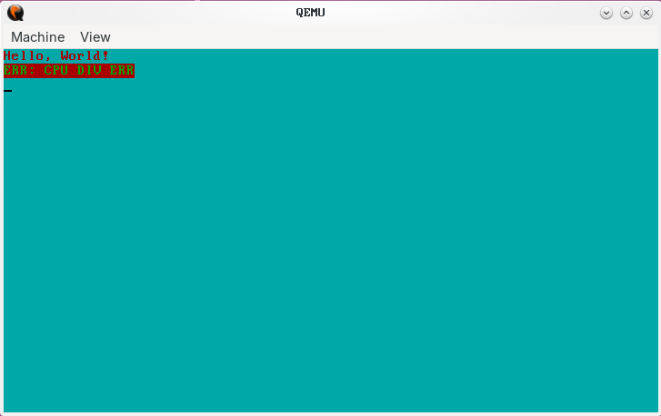

## 32 bit protected mode OS 

# Custom Bootloader

Loads the kernel from an elf, parsing program headers to correctly load the kernel

Uses unreal mode to load the kernel (From FAT32) into higher memory while in real mode

Maps memory using e820, enables a20 line, creates temporary GDT, and loads protected mode

Successfully boots into a test kernel that prints a welcome message

# Kernel

Not yet started

